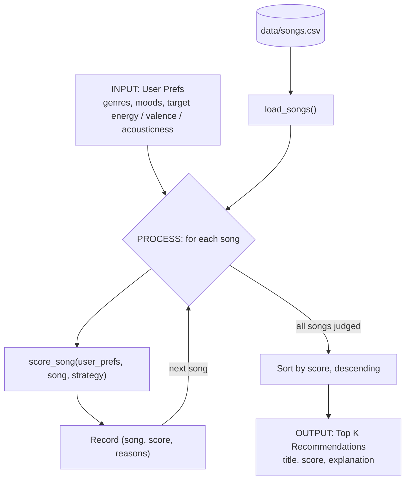

# 🎵 Music Recommender Simulation

## Project Summary

In this project you will build and explain a small music recommender system.

Your goal is to:

- Represent songs and a user "taste profile" as data
- Design a scoring rule that turns that data into recommendations
- Evaluate what your system gets right and wrong
- Reflect on how this mirrors real world AI recommenders

Replace this paragraph with your own summary of what your version does.

---

## How The System Works

Real-world recommenders such as Spotify's combine two broad approaches: collaborative filtering, which learns from what millions of other listeners play, skip and save, and content-based filtering, which compares the measurable characteristics of songs (genre, tempo, energy, mood) to what a listener already likes. My version is purely content-based. It has no listening history and no other users, so it can only compare a song's attributes to a single stated taste profile. It prioritizes **closeness of match** over popularity or novelty. Each song gets a score for how well it fits the user, and the highest-scoring songs are recommended. By default (the `balanced` mode), genre, mood and energy each count equally, and valence and acousticness count half as much. Energy, valence and acousticness are rewarded for being *near* the user's target, not for being high. Other ranking modes shift these weights, and I compare them in [Experiment 2](#experiment-2-ranking-modes-and-why-balanced-is-the-default).

### Features used

**`Song`** (each row of `data/songs.csv`):

- `genre`, `mood`: categorical, used in scoring
- `energy`, `valence`, `acousticness` (0-1): numeric, used in scoring
- `tempo_bpm`, `danceability`: stored for each song but not scored yet
- `id`, `title`, `artist`: identifiers, used for display only, not scoring

**User profile** (the dictionaries in `main.py`):

- `favorite_genres`, `favorite_moods`: sets of labels the user likes
- `target_energy`, `target_valence`, `target_acousticness` (0-1): the levels the user wants

The `UserProfile` class used by the `Recommender` class is a simpler version with one genre, one mood, `target_energy` and `likes_acoustic`.

### Data flow



### Algorithm Recipe

Each song is scored on its own (the **scoring rule**), then all songs are sorted and the top `k` are returned (the **ranking rule**). These are the weights of the default `balanced` mode.

| Signal | Points | Rule |
|---|---|---|
| Genre match | +1.0 | song genre is one of `favorite_genres`, otherwise 0 |
| Mood match | +1.0 | song mood is one of `favorite_moods`, otherwise 0 |
| Energy similarity | 0.0 to +1.0 | `1.0 * (1 - abs(song.energy - target_energy))` |
| Valence similarity | 0.0 to +0.5 | `0.5 * (1 - abs(song.valence - target_valence))` |
| Acousticness similarity | 0.0 to +0.5 | `0.5 * (1 - abs(song.acousticness - target_acousticness))` |

```
score = 1.0 * genre_match + 1.0 * mood_match
      + 1.0 * (1 - |energy gap|) + 0.5 * (1 - |valence gap|) + 0.5 * (1 - |acousticness gap|)
```

- **Maximum score:** 4.0 (every signal matches perfectly). Every ranking mode's weights add up to 4.0. If a profile has no target for a signal, the remaining weights are rescaled so the maximum is still 4.0.
- **Why genre is worth the same as mood:** genre labels are coarse and exact-match, so letting one label count double made a single tag decide the ranking (see the Genre Trap test in [Experiment 2](#experiment-2-ranking-modes-and-why-balanced-is-the-default)).
- **Why closeness:** rewarding raw energy would always favor loud songs. Closeness lets a user who wants calm music get calm songs.
- **Ranking rule:** sort by score, highest first, and break ties by smaller energy gap, then title, so results are deterministic. Return the top `k` with a plain-language reason for each (for example, "genre match: pop (+1.0)").
- **Switching modes:** the weights live in the `STRATEGIES` table in `src/recommender.py`. The original formula is kept as `classic`, and there are three more experimental modes.

### Expected biases

- **Exact-match labels.** "pop" and "indie pop", or "hip-hop", "rap" and "trap", count as completely different genres, so closely related songs get no credit.
- **Tiny catalog.** Most genres have only one song, so a genre match often decides one slot in the top 5 and the rest is filled by mood and numbers. Users whose genre is not in the catalog get recommendations driven only by the numbers.
- **Mood is all-or-nothing.** "chill" and "relaxed" are treated as unrelated, even though a listener would likely enjoy both.
- **Unused features.** Tempo and danceability are ignored, and valence and acousticness are worth only half as much as the other signals, so two songs that feel very different can still score alike.
- **Genre can dominate in some modes.** In `classic` and `genre_first`, a song in the right genre but the wrong mood and energy can outrank a song that fits the user's mood and energy perfectly. The default `balanced` mode was chosen to avoid this.
- **Single-profile assumption.** One fixed taste profile cannot capture a listener whose preferences change by context, and there is no novelty, so the system tends to repeat the same kind of song.

---

## Getting Started

### Setup

1. Create a virtual environment (optional but recommended):

   ```bash
   python -m venv .venv
   source .venv/bin/activate      # Mac or Linux
   .venv\Scripts\activate         # Windows

2. Install dependencies

```bash
pip install -r requirements.txt
```

3. Run the app (from the project folder):

```bash
python src/main.py                          # default "balanced" mode
python src/main.py --strategy classic       # the original formula
python src/main.py --strategy all           # every mode, for comparison
```

The other modes are `genre_first`, `mood_first` and `energy_focused`. You can also change the `STRATEGY` constant at the top of `src/main.py`.

### Running Tests

Run the starter tests with:

```bash
pytest
```

You can add more tests in `tests/test_recommender.py`.

---

## Sample Recommendation Output

Output of `python src/main.py` (the default `balanced` mode) for the four built-in profiles (`my_taste`, `high_energy`, `low_energy`, `happy_pop`). Each song shows its final score out of 4.00 and the reasons that produced it. The original `classic` output is in [Experiment 2](#experiment-2-ranking-modes-and-why-balanced-is-the-default).

```
================================================================
 Top 5 recommendations for: my_taste
================================================================

1. Love Yourz  by J. Cole
   Score: 3.87 / 4.00
   Why:
     - genre match: rap (+1.0)
     - mood match: reflective (+1.0)
     - energy 0.48 vs target 0.50 (+0.98)
     - valence 0.65 vs target 0.50 (+0.42)
     - acousticness 0.28 vs target 0.35 (+0.47)

2. Heart on Ice  by Rod Wave
   Score: 3.69 / 4.00
   Why:
     - genre match: hip-hop (+1.0)
     - mood match: melancholic (+1.0)
     - energy 0.38 vs target 0.50 (+0.88)
     - valence 0.19 vs target 0.50 (+0.34)
     - acousticness 0.42 vs target 0.35 (+0.46)

3. First Day Out  by Tee Grizzley
   Score: 2.34 / 4.00
   Why:
     - genre match: trap (+1.0)
     - energy 0.94 vs target 0.50 (+0.56)
     - valence 0.35 vs target 0.50 (+0.42)
     - acousticness 0.06 vs target 0.35 (+0.35)

4. Let Me Love You  by Mario
   Score: 1.83 / 4.00
   Why:
     - energy 0.54 vs target 0.50 (+0.96)
     - valence 0.72 vs target 0.50 (+0.39)
     - acousticness 0.31 vs target 0.35 (+0.48)

5. Midnight Coding  by LoRoom
   Score: 1.71 / 4.00
   Why:
     - energy 0.42 vs target 0.50 (+0.92)
     - valence 0.56 vs target 0.50 (+0.47)
     - acousticness 0.71 vs target 0.35 (+0.32)

----------------------------------------------------------------

================================================================
 Top 5 recommendations for: high_energy
================================================================

1. Levels  by Avicii
   Score: 3.92 / 4.00
   Why:
     - genre match: EDM (+1.0)
     - mood match: uplifting (+1.0)
     - energy 0.95 vs target 0.95 (+1.00)
     - valence 0.94 vs target 0.80 (+0.43)
     - acousticness 0.02 vs target 0.05 (+0.48)

2. First Day Out  by Tee Grizzley
   Score: 3.76 / 4.00
   Why:
     - genre match: trap (+1.0)
     - mood match: aggressive (+1.0)
     - energy 0.94 vs target 0.95 (+0.99)
     - valence 0.35 vs target 0.80 (+0.27)
     - acousticness 0.06 vs target 0.05 (+0.49)

3. Enter Sandman  by Metallica
   Score: 2.67 / 4.00
   Why:
     - genre match: metal (+1.0)
     - energy 0.97 vs target 0.95 (+0.98)
     - valence 0.22 vs target 0.80 (+0.21)
     - acousticness 0.01 vs target 0.05 (+0.48)

4. Gym Hero  by Max Pulse
   Score: 1.97 / 4.00
   Why:
     - energy 0.93 vs target 0.95 (+0.98)
     - valence 0.77 vs target 0.80 (+0.48)
     - acousticness 0.05 vs target 0.05 (+0.50)

5. Sunrise City  by Neon Echo
   Score: 1.79 / 4.00
   Why:
     - energy 0.82 vs target 0.95 (+0.87)
     - valence 0.84 vs target 0.80 (+0.48)
     - acousticness 0.18 vs target 0.05 (+0.43)

----------------------------------------------------------------

================================================================
 Top 5 recommendations for: low_energy
================================================================

1. Clair de Lune  by Claude Debussy
   Score: 3.90 / 4.00
   Why:
     - genre match: classical (+1.0)
     - mood match: dreamy (+1.0)
     - energy 0.14 vs target 0.20 (+0.94)
     - valence 0.29 vs target 0.30 (+0.49)
     - acousticness 0.98 vs target 0.90 (+0.46)

2. Spacewalk Thoughts  by Orbit Bloom
   Score: 3.74 / 4.00
   Why:
     - genre match: ambient (+1.0)
     - mood match: chill (+1.0)
     - energy 0.28 vs target 0.20 (+0.92)
     - valence 0.65 vs target 0.30 (+0.32)
     - acousticness 0.92 vs target 0.90 (+0.49)

3. Library Rain  by Paper Lanterns
   Score: 3.68 / 4.00
   Why:
     - genre match: lofi (+1.0)
     - mood match: chill (+1.0)
     - energy 0.35 vs target 0.20 (+0.85)
     - valence 0.60 vs target 0.30 (+0.35)
     - acousticness 0.86 vs target 0.90 (+0.48)

4. Midnight Coding  by LoRoom
   Score: 3.56 / 4.00
   Why:
     - genre match: lofi (+1.0)
     - mood match: chill (+1.0)
     - energy 0.42 vs target 0.20 (+0.78)
     - valence 0.56 vs target 0.30 (+0.37)
     - acousticness 0.71 vs target 0.90 (+0.40)

5. Focus Flow  by LoRoom
   Score: 2.60 / 4.00
   Why:
     - genre match: lofi (+1.0)
     - energy 0.40 vs target 0.20 (+0.80)
     - valence 0.59 vs target 0.30 (+0.35)
     - acousticness 0.78 vs target 0.90 (+0.44)

----------------------------------------------------------------

================================================================
 Top 5 recommendations for: happy_pop
================================================================

1. Sunrise City  by Neon Echo
   Score: 3.95 / 4.00
   Why:
     - genre match: pop (+1.0)
     - mood match: happy (+1.0)
     - energy 0.82 vs target 0.80 (+0.98)
     - valence 0.84 vs target 0.80 (+0.48)
     - acousticness 0.18 vs target 0.20 (+0.49)

2. Rooftop Lights  by Indigo Parade
   Score: 2.88 / 4.00
   Why:
     - mood match: happy (+1.0)
     - energy 0.76 vs target 0.80 (+0.96)
     - valence 0.81 vs target 0.80 (+0.49)
     - acousticness 0.35 vs target 0.20 (+0.43)

3. Gym Hero  by Max Pulse
   Score: 2.78 / 4.00
   Why:
     - genre match: pop (+1.0)
     - energy 0.93 vs target 0.80 (+0.87)
     - valence 0.77 vs target 0.80 (+0.48)
     - acousticness 0.05 vs target 0.20 (+0.42)

4. Rock with You  by Michael Jackson
   Score: 1.88 / 4.00
   Why:
     - energy 0.76 vs target 0.80 (+0.96)
     - valence 0.89 vs target 0.80 (+0.46)
     - acousticness 0.12 vs target 0.20 (+0.46)

5. Night Drive Loop  by Neon Echo
   Score: 1.78 / 4.00
   Why:
     - energy 0.75 vs target 0.80 (+0.95)
     - valence 0.49 vs target 0.80 (+0.34)
     - acousticness 0.22 vs target 0.20 (+0.49)

----------------------------------------------------------------
```

---

## Adversarial Profile Output

Output of `python src/main.py` (the default `balanced` mode) for the nine edge-case profiles in `adversarial_profiles`, each designed to probe the scoring logic. Each block is one profile's terminal output.

### Sad Banger

```
================================================================
 Top 5 recommendations for: Sad Banger
================================================================

1. Levels  by Avicii
   Score: 2.56 / 4.00
   Why:
     - genre match: EDM (+1.0)
     - energy 0.95 vs target 0.95 (+1.00)
     - valence 0.94 vs target 0.10 (+0.08)
     - acousticness 0.02 vs target 0.05 (+0.48)

2. Heart on Ice  by Rod Wave
   Score: 2.20 / 4.00
   Why:
     - mood match: melancholic (+1.0)
     - energy 0.38 vs target 0.95 (+0.43)
     - valence 0.19 vs target 0.10 (+0.46)
     - acousticness 0.42 vs target 0.05 (+0.32)

3. Love Yourz  by J. Cole
   Score: 2.14 / 4.00
   Why:
     - mood match: reflective (+1.0)
     - energy 0.48 vs target 0.95 (+0.53)
     - valence 0.65 vs target 0.10 (+0.22)
     - acousticness 0.28 vs target 0.05 (+0.39)

4. Enter Sandman  by Metallica
   Score: 1.90 / 4.00
   Why:
     - energy 0.97 vs target 0.95 (+0.98)
     - valence 0.22 vs target 0.10 (+0.44)
     - acousticness 0.01 vs target 0.05 (+0.48)

5. First Day Out  by Tee Grizzley
   Score: 1.86 / 4.00
   Why:
     - energy 0.94 vs target 0.95 (+0.99)
     - valence 0.35 vs target 0.10 (+0.38)
     - acousticness 0.06 vs target 0.05 (+0.49)

----------------------------------------------------------------
```

**What this shows:** "Levels" is still #1, but it scores only 2.56 because its valence (0.94) is far from the 0.10 target. The two quiet sad songs take #2 and #3. "Enter Sandman" (loud, valence 0.22) is #4. It is the closest thing to a sad banger in the catalog.

### Calm Genre, Max Energy

```
================================================================
 Top 5 recommendations for: Calm Genre, Max Energy
================================================================

1. Spacewalk Thoughts  by Orbit Bloom
   Score: 3.19 / 4.00
   Why:
     - genre match: ambient (+1.0)
     - mood match: chill (+1.0)
     - energy 0.28 vs target 1.00 (+0.28)
     - valence 0.65 vs target 0.50 (+0.42)
     - acousticness 0.92 vs target 0.95 (+0.49)

2. Clair de Lune  by Claude Debussy
   Score: 3.02 / 4.00
   Why:
     - genre match: classical (+1.0)
     - mood match: dreamy (+1.0)
     - energy 0.14 vs target 1.00 (+0.14)
     - valence 0.29 vs target 0.50 (+0.40)
     - acousticness 0.98 vs target 0.95 (+0.48)

3. Midnight Coding  by LoRoom
   Score: 2.27 / 4.00
   Why:
     - mood match: chill (+1.0)
     - energy 0.42 vs target 1.00 (+0.42)
     - valence 0.56 vs target 0.50 (+0.47)
     - acousticness 0.71 vs target 0.95 (+0.38)

4. Library Rain  by Paper Lanterns
   Score: 2.25 / 4.00
   Why:
     - mood match: chill (+1.0)
     - energy 0.35 vs target 1.00 (+0.35)
     - valence 0.60 vs target 0.50 (+0.45)
     - acousticness 0.86 vs target 0.95 (+0.46)

5. Storm Runner  by Voltline
   Score: 1.47 / 4.00
   Why:
     - energy 0.91 vs target 1.00 (+0.91)
     - valence 0.48 vs target 0.50 (+0.49)
     - acousticness 0.10 vs target 0.95 (+0.08)

----------------------------------------------------------------
```

**What this shows:** Genre and mood points (2 of 4) still put the two quiet songs on top, even though the energy target is 1.0. Only #5, "Storm Runner", answers the loud request.

### Genre Trap

```
================================================================
 Top 5 recommendations for: Genre Trap
================================================================

1. Spacewalk Thoughts  by Orbit Bloom
   Score: 2.83 / 4.00
   Why:
     - mood match: chill (+1.0)
     - energy 0.28 vs target 0.20 (+0.92)
     - valence 0.65 vs target 0.50 (+0.42)
     - acousticness 0.92 vs target 0.90 (+0.49)

2. Library Rain  by Paper Lanterns
   Score: 2.78 / 4.00
   Why:
     - mood match: chill (+1.0)
     - energy 0.35 vs target 0.20 (+0.85)
     - valence 0.60 vs target 0.50 (+0.45)
     - acousticness 0.86 vs target 0.90 (+0.48)

3. Coffee Shop Stories  by Slow Stereo
   Score: 2.72 / 4.00
   Why:
     - mood match: relaxed (+1.0)
     - energy 0.37 vs target 0.20 (+0.83)
     - valence 0.71 vs target 0.50 (+0.40)
     - acousticness 0.89 vs target 0.90 (+0.49)

4. Midnight Coding  by LoRoom
   Score: 2.65 / 4.00
   Why:
     - mood match: chill (+1.0)
     - energy 0.42 vs target 0.20 (+0.78)
     - valence 0.56 vs target 0.50 (+0.47)
     - acousticness 0.71 vs target 0.90 (+0.40)

5. Clair de Lune  by Claude Debussy
   Score: 1.79 / 4.00
   Why:
     - energy 0.14 vs target 0.20 (+0.94)
     - valence 0.29 vs target 0.50 (+0.40)
     - acousticness 0.98 vs target 0.90 (+0.46)

----------------------------------------------------------------
```

**What this shows:** The calm songs win, and "Enter Sandman" is not in the top 5. In `classic` mode it was #1 with 2.23.

### Impossible Energy

```
================================================================
 Top 5 recommendations for: Impossible Energy
================================================================

1. Sunrise City  by Neon Echo
   Score: 1.85 / 4.00
   Why:
     - genre match: pop (+1.0)
     - mood match: happy (+1.0)
     - energy 0.82 vs target -1.00 (+-0.82)
     - valence 0.84 vs target 0.50 (+0.33)
     - acousticness 0.18 vs target 0.50 (+0.34)

2. Rooftop Lights  by Indigo Parade
   Score: 1.01 / 4.00
   Why:
     - mood match: happy (+1.0)
     - energy 0.76 vs target -1.00 (+-0.76)
     - valence 0.81 vs target 0.50 (+0.34)
     - acousticness 0.35 vs target 0.50 (+0.42)

3. Gym Hero  by Max Pulse
   Score: 0.71 / 4.00
   Why:
     - genre match: pop (+1.0)
     - energy 0.93 vs target -1.00 (+-0.93)
     - valence 0.77 vs target 0.50 (+0.36)
     - acousticness 0.05 vs target 0.50 (+0.28)

4. Clair de Lune  by Claude Debussy
   Score: 0.51 / 4.00
   Why:
     - energy 0.14 vs target -1.00 (+-0.14)
     - valence 0.29 vs target 0.50 (+0.40)
     - acousticness 0.98 vs target 0.50 (+0.26)

5. Midnight Coding  by LoRoom
   Score: 0.45 / 4.00
   Why:
     - energy 0.42 vs target -1.00 (+-0.42)
     - valence 0.56 vs target 0.50 (+0.47)
     - acousticness 0.71 vs target 0.50 (+0.40)

----------------------------------------------------------------
```

**What this shows:** Every energy line shows a negative number, but the totals stay above zero because valence and acousticness add points. The bug is hidden, not fixed.

### Wrong Case

```
================================================================
 Top 5 recommendations for: Wrong Case
================================================================

1. Night Drive Loop  by Neon Echo
   Score: 1.80 / 4.00
   Why:
     - energy 0.75 vs target 0.70 (+0.95)
     - valence 0.49 vs target 0.50 (+0.49)
     - acousticness 0.22 vs target 0.50 (+0.36)

2. Rooftop Lights  by Indigo Parade
   Score: 1.71 / 4.00
   Why:
     - energy 0.76 vs target 0.70 (+0.94)
     - valence 0.81 vs target 0.50 (+0.34)
     - acousticness 0.35 vs target 0.50 (+0.42)

3. Let Me Love You  by Mario
   Score: 1.64 / 4.00
   Why:
     - energy 0.54 vs target 0.70 (+0.84)
     - valence 0.72 vs target 0.50 (+0.39)
     - acousticness 0.31 vs target 0.50 (+0.41)

4. Love Yourz  by J. Cole
   Score: 1.60 / 4.00
   Why:
     - energy 0.48 vs target 0.70 (+0.78)
     - valence 0.65 vs target 0.50 (+0.42)
     - acousticness 0.28 vs target 0.50 (+0.39)

5. Midnight Coding  by LoRoom
   Score: 1.58 / 4.00
   Why:
     - energy 0.42 vs target 0.70 (+0.72)
     - valence 0.56 vs target 0.50 (+0.47)
     - acousticness 0.71 vs target 0.50 (+0.40)

----------------------------------------------------------------
```

**What this shows:** Capital letters hide every genre and mood match. The list is only songs near the numbers, and the top score is 1.80.

### Unknown Tastes

```
================================================================
 Top 5 recommendations for: Unknown Tastes
================================================================

1. Love Yourz  by J. Cole
   Score: 1.79 / 4.00
   Why:
     - energy 0.48 vs target 0.50 (+0.98)
     - valence 0.65 vs target 0.50 (+0.42)
     - acousticness 0.28 vs target 0.50 (+0.39)

2. Midnight Coding  by LoRoom
   Score: 1.78 / 4.00
   Why:
     - energy 0.42 vs target 0.50 (+0.92)
     - valence 0.56 vs target 0.50 (+0.47)
     - acousticness 0.71 vs target 0.50 (+0.40)

3. Let Me Love You  by Mario
   Score: 1.76 / 4.00
   Why:
     - energy 0.54 vs target 0.50 (+0.96)
     - valence 0.72 vs target 0.50 (+0.39)
     - acousticness 0.31 vs target 0.50 (+0.41)

4. Focus Flow  by LoRoom
   Score: 1.71 / 4.00
   Why:
     - energy 0.40 vs target 0.50 (+0.90)
     - valence 0.59 vs target 0.50 (+0.46)
     - acousticness 0.78 vs target 0.50 (+0.36)

5. Heart on Ice  by Rod Wave
   Score: 1.69 / 4.00
   Why:
     - energy 0.38 vs target 0.50 (+0.88)
     - valence 0.19 vs target 0.50 (+0.34)
     - acousticness 0.42 vs target 0.50 (+0.46)

----------------------------------------------------------------
```

**What this shows:** Nothing matches, so the numbers decide. The system still shows five songs with no warning.

### Likes Everything

```
================================================================
 Top 5 recommendations for: Likes Everything
================================================================

1. Love Yourz  by J. Cole
   Score: 3.79 / 4.00
   Why:
     - genre match: rap (+1.0)
     - mood match: reflective (+1.0)
     - energy 0.48 vs target 0.50 (+0.98)
     - valence 0.65 vs target 0.50 (+0.42)
     - acousticness 0.28 vs target 0.50 (+0.39)

2. Midnight Coding  by LoRoom
   Score: 3.78 / 4.00
   Why:
     - genre match: lofi (+1.0)
     - mood match: chill (+1.0)
     - energy 0.42 vs target 0.50 (+0.92)
     - valence 0.56 vs target 0.50 (+0.47)
     - acousticness 0.71 vs target 0.50 (+0.40)

3. Let Me Love You  by Mario
   Score: 3.75 / 4.00
   Why:
     - genre match: R&B (+1.0)
     - mood match: romantic (+1.0)
     - energy 0.54 vs target 0.50 (+0.96)
     - valence 0.72 vs target 0.50 (+0.39)
     - acousticness 0.31 vs target 0.50 (+0.41)

4. Focus Flow  by LoRoom
   Score: 3.71 / 4.00
   Why:
     - genre match: lofi (+1.0)
     - mood match: focused (+1.0)
     - energy 0.40 vs target 0.50 (+0.90)
     - valence 0.59 vs target 0.50 (+0.46)
     - acousticness 0.78 vs target 0.50 (+0.36)

5. Heart on Ice  by Rod Wave
   Score: 3.68 / 4.00
   Why:
     - genre match: hip-hop (+1.0)
     - mood match: melancholic (+1.0)
     - energy 0.38 vs target 0.50 (+0.88)
     - valence 0.19 vs target 0.50 (+0.34)
     - acousticness 0.42 vs target 0.50 (+0.46)

----------------------------------------------------------------
```

**What this shows:** Every song gets +2.0 for genre and mood, so only the numbers differ. The list is the same five songs in the same order as Unknown Tastes, shifted up by 2.0.

### Empty Prefs

```
================================================================
 Empty Prefs: FAILED with KeyError: 'favorite_genre'
================================================================
----------------------------------------------------------------
```

**What this shows:** An empty profile crashes the program with a `KeyError`.

### Dead Center

```
================================================================
 Top 5 recommendations for: Dead Center
================================================================

1. Coffee Shop Stories  by Slow Stereo
   Score: 3.57 / 4.00
   Why:
     - genre match: jazz (+1.0)
     - mood match: relaxed (+1.0)
     - energy 0.37 vs target 0.50 (+0.87)
     - valence 0.71 vs target 0.50 (+0.40)
     - acousticness 0.89 vs target 0.50 (+0.30)

2. Love Yourz  by J. Cole
   Score: 1.79 / 4.00
   Why:
     - energy 0.48 vs target 0.50 (+0.98)
     - valence 0.65 vs target 0.50 (+0.42)
     - acousticness 0.28 vs target 0.50 (+0.39)

3. Midnight Coding  by LoRoom
   Score: 1.78 / 4.00
   Why:
     - energy 0.42 vs target 0.50 (+0.92)
     - valence 0.56 vs target 0.50 (+0.47)
     - acousticness 0.71 vs target 0.50 (+0.40)

4. Let Me Love You  by Mario
   Score: 1.76 / 4.00
   Why:
     - energy 0.54 vs target 0.50 (+0.96)
     - valence 0.72 vs target 0.50 (+0.39)
     - acousticness 0.31 vs target 0.50 (+0.41)

5. Focus Flow  by LoRoom
   Score: 1.71 / 4.00
   Why:
     - energy 0.40 vs target 0.50 (+0.90)
     - valence 0.59 vs target 0.50 (+0.46)
     - acousticness 0.78 vs target 0.50 (+0.36)

----------------------------------------------------------------
```

**What this shows:** One real jazz and relaxed match scores 3.57. The next four are filler songs near the numbers, at about 1.7 to 1.8.

---

## Experiments You Tried

### Experiment 1: Weight shift (genre halved, energy doubled)

**Change:** `GENRE_POINTS` 2.0 → 1.0 and energy weight 1.0 → 2.0 (new `ENERGY_POINTS` constant). Mood stayed at 1.0. The maximum score stays 1.0 + 1.0 + 2.0 = 4.0, so `MAX_SCORE` in `main.py` remained valid. I reran all twelve profiles and compared the top 5 to the `classic` baseline. The weights have since been reverted, and `classic` is now one of the modes in Experiment 2.

| Profile | Before | After |
|---|---|---|
| my_taste, high_energy, low_energy | Love Yourz / Levels / Clair de Lune at #1 | Same top 5 in the same order. Scores dipped slightly (e.g. 3.98 → 3.96). |
| **Genre Trap** | #1 Enter Sandman (2.23) | #1 **Spacewalk Thoughts (2.84)**. Enter Sandman fell out of the top 5. |
| Calm Genre, Max Energy | Quiet lofi tracks filled ranks 3-4 | Loud tracks (Enter Sandman, Levels, First Day Out) moved in. Same #1. |
| Sad Banger | #1 Levels (3.00) | Same #1. The sad "Heart on Ice" dropped out of the top 5. |
| Impossible Energy | #1 Sunrise City (2.18), lowest score -0.28 | Same #1 at 0.36. Lowest score fell to -0.70. |
| Wrong Case, Unknown Tastes | Top score 0.95 / 0.98 | Same top 5, scores doubled (1.90 / 1.96). Only energy contributes. |
| Likes Everything, Dead Center | No change in ranking | No change in ranking. Scores moved slightly. |
| Empty Prefs | `KeyError` | Unchanged. The crash is unrelated to the weights. |

**What I learned:**

- Ordinary profiles were stable under the weight change. Genre dominance showed up in the conflicting profiles, especially Genre Trap, where the metal genre match outweighed a poor energy and mood fit.
- Doubling energy fixed Genre Trap but over-corrected. Now the energy fit can beat a genre and mood match, so the genre-over-energy bias swapped sides instead of disappearing.
- The unclamped energy term made the negative-score bug worse, because the energy penalty doubled. Clamping energy points at 0 would be a prerequisite for any future weight tuning.

### Experiment 2: Ranking modes (and why `balanced` is the default)

**Change:** I added valence and acousticness to the score and moved the weights into a `STRATEGIES` table in `recommender.py`, so I can switch modes with `python src/main.py --strategy <mode>` (or `--strategy all`). Every mode's weights sum to 4.0. I tried five candidate weightings, then made `balanced` the default because genre is worth no more than any other signal. The original formula is kept as `classic`, and the other three modes are experiments.

| Mode | genre | mood | energy | valence | acousticness |
|---|---|---|---|---|---|
| **`balanced`** (default) | 1.0 | 1.0 | 1.0 | 0.5 | 0.5 |
| `classic` (original) | 2.0 | 1.0 | 1.0 | 0 | 0 |
| `genre_first` | 2.5 | 0.5 | 0.5 | 0.25 | 0.25 |
| `mood_first` | 0.5 | 2.0 | 0.5 | 0.75 | 0.25 |
| `energy_focused` | 0.5 | 0.5 | 2.0 | 0.5 | 0.5 |

**How the modes measure up.** I ran every mode on 8 profiles (`my_taste`, `high_energy`, `low_energy`, `happy_pop`, Sad Banger, Calm Genre Max Energy, Genre Trap and Dead Center) and averaged the top 5 for each. Lower gaps mean the songs sit closer to what the user asked for.

| Mode | Genre matches (of 5) | Mood matches (of 5) | Energy gap | Valence gap | Acousticness gap | Score gap, #1 to #5 | Distinct genres |
|---|---|---|---|---|---|---|---|
| `balanced` | 2.12 | 2.62 | 0.17 | 0.19 | **0.14** | 1.63 | 4.1 |
| `classic` | **2.25** | 2.62 | 0.19 | 0.22 | 0.16 | 2.25 | 4.3 |
| `genre_first` | **2.25** | 2.62 | 0.19 | 0.19 | 0.16 | **2.44** | 4.1 |
| `mood_first` | 2.12 | 2.62 | 0.19 | **0.17** | **0.14** | 2.31 | 4.0 |
| `energy_focused` | 1.88 | 2.00 | **0.09** | 0.22 | 0.18 | 0.83 | 4.3 |

### Tradeoffs of each mode

| Mode | Good for | Tradeoff | Example from my tests |
|---|---|---|---|
| **`balanced`** (default) | General use. No single label can decide the ranking, and all five signals count. | Scores bunch closer together (a #1-to-#5 gap of 1.63 vs 2.25 in `classic`), so near-ties are more common. It is also a little less loyal to genre (2.12 genre matches vs 2.25). | Genre Trap's #1 is the calm "Spacewalk Thoughts". For Happy Pop, "Rooftop Lights" ranks above "Gym Hero". |
| `classic` | The simplest to explain. It has wide score gaps (2.25) and the most genre loyalty (2.25 genre matches). | A genre match can win alone, and valence and acousticness are ignored, so it can't tell a sad song from a happy one. | The loud metal song "Enter Sandman" is #1 for a listener who asked for calm music. "Gym Hero" is #2 for Happy Pop. |
| `genre_first` | Listeners who care mostly about genre. It has the biggest score gaps (2.44), so its top picks stand out most. | It has the same genre problem as `classic`, only stronger. With 13 one-song genres it finds one true match and fills the rest by energy. | "Enter Sandman" is still #1 for Genre Trap, and "Gym Hero" is still #2 for Happy Pop. |
| `mood_first` | Mood-driven listening (study, sad, party). It has the best valence match (0.17). | Moods are exact labels and most have one song, so lists can swing between very different energy levels and can ignore an energy request. | Sad Banger asked for energy 0.95 but gets the quiet sad songs first ("Heart on Ice" has energy 0.38). `my_taste` gets a synthwave song at #4. |
| `energy_focused` | Contexts where loudness matters most, like a workout or sleep. It has the closest energy match by far (0.09). | Taste washes out. It has the fewest genre (1.88) and mood (2.00) matches and the smallest score gaps (0.83), so many songs nearly tie. | Calm Genre, Max Energy gets loud songs from several genres. `my_taste` loses "First Day Out" and gets "Focus Flow", a lofi song. |

**One tradeoff that applies to every mode:** none of them fix the filter bubble. Every mode returns about 4 distinct genres in 5 songs, so changing the weights changes *which* songs win but not how much variety the user sees. That needs a diversity rule, not different weights.

### `classic` vs `balanced` (top 5)

| Profile | `classic` | `balanced` (default) |
|---|---|---|
| **Genre Trap** | #1 Enter Sandman (2.23) | #1 **Spacewalk Thoughts (2.83)**. Enter Sandman is out of the top 5. |
| **Happy Pop** (pop, happy, energy 0.8) | Sunrise City, **Gym Hero**, Rooftop Lights | Sunrise City, **Rooftop Lights**, Gym Hero. The better-sounding song moves up. |
| Sad Banger | Levels, Love Yourz, Heart on Ice | Levels, Heart on Ice, Love Yourz. The low valence target now counts, and the sad songs score higher. |
| high_energy | Levels, First Day Out, Enter Sandman, Gym Hero, Storm Runner | Same first three, then Gym Hero and Sunrise City. |
| my_taste, low_energy | Love Yourz / Clair de Lune lead | Same top 5 in the same order, with slightly lower scores. |
| Calm Genre, Max Energy | Spacewalk Thoughts, Clair de Lune, ... | Same top two. Ranks 3 to 5 shift (Storm Runner replaces Enter Sandman at #5). |
| Wrong Case, Unknown Tastes | Energy-only lists, scores below 1.0 | Same kind of list, scores near 1.8. Valence and acousticness now break ties. |

**What I learned:**

- Lowering the genre weight fixed the two headline problems (Genre Trap and the Gym Hero results) while keeping the normal profiles stable. `my_taste` and `low_energy` kept their exact top 5, and `high_energy` changed one song.
- Scores spread out less in `balanced`. Sad Banger's #1-to-#5 gap shrinks from 2.02 to about 0.7, so near-ties are more common.
- Each mode just changes which signal wins. A user who picks a mode picks which bias they accept.
- `balanced` shows no negative scores for Impossible Energy, but only because the valence and acousticness terms offset the negative energy term. The energy term itself can still go negative, so the clamping fix is still needed.

<details>
<summary>Full output of the original <code>classic</code> mode (all 13 profiles)</summary>

```
================================================================
 Top 5 recommendations for: my_taste
================================================================

1. Love Yourz  by J. Cole
   Score: 3.98 / 4.00
   Why:
     - genre match: rap (+2.0)
     - mood match: reflective (+1.0)
     - energy 0.48 vs target 0.50 (+0.98)

2. Heart on Ice  by Rod Wave
   Score: 3.88 / 4.00
   Why:
     - genre match: hip-hop (+2.0)
     - mood match: melancholic (+1.0)
     - energy 0.38 vs target 0.50 (+0.88)

3. First Day Out  by Tee Grizzley
   Score: 2.56 / 4.00
   Why:
     - genre match: trap (+2.0)
     - energy 0.94 vs target 0.50 (+0.56)

4. Let Me Love You  by Mario
   Score: 0.96 / 4.00
   Why:
     - energy 0.54 vs target 0.50 (+0.96)

5. Midnight Coding  by LoRoom
   Score: 0.92 / 4.00
   Why:
     - energy 0.42 vs target 0.50 (+0.92)

----------------------------------------------------------------

================================================================
 Top 5 recommendations for: high_energy
================================================================

1. Levels  by Avicii
   Score: 4.00 / 4.00
   Why:
     - genre match: EDM (+2.0)
     - mood match: uplifting (+1.0)
     - energy 0.95 vs target 0.95 (+1.00)

2. First Day Out  by Tee Grizzley
   Score: 3.99 / 4.00
   Why:
     - genre match: trap (+2.0)
     - mood match: aggressive (+1.0)
     - energy 0.94 vs target 0.95 (+0.99)

3. Enter Sandman  by Metallica
   Score: 2.98 / 4.00
   Why:
     - genre match: metal (+2.0)
     - energy 0.97 vs target 0.95 (+0.98)

4. Gym Hero  by Max Pulse
   Score: 0.98 / 4.00
   Why:
     - energy 0.93 vs target 0.95 (+0.98)

5. Storm Runner  by Voltline
   Score: 0.96 / 4.00
   Why:
     - energy 0.91 vs target 0.95 (+0.96)

----------------------------------------------------------------

================================================================
 Top 5 recommendations for: low_energy
================================================================

1. Clair de Lune  by Claude Debussy
   Score: 3.94 / 4.00
   Why:
     - genre match: classical (+2.0)
     - mood match: dreamy (+1.0)
     - energy 0.14 vs target 0.20 (+0.94)

2. Spacewalk Thoughts  by Orbit Bloom
   Score: 3.92 / 4.00
   Why:
     - genre match: ambient (+2.0)
     - mood match: chill (+1.0)
     - energy 0.28 vs target 0.20 (+0.92)

3. Library Rain  by Paper Lanterns
   Score: 3.85 / 4.00
   Why:
     - genre match: lofi (+2.0)
     - mood match: chill (+1.0)
     - energy 0.35 vs target 0.20 (+0.85)

4. Midnight Coding  by LoRoom
   Score: 3.78 / 4.00
   Why:
     - genre match: lofi (+2.0)
     - mood match: chill (+1.0)
     - energy 0.42 vs target 0.20 (+0.78)

5. Focus Flow  by LoRoom
   Score: 2.80 / 4.00
   Why:
     - genre match: lofi (+2.0)
     - energy 0.40 vs target 0.20 (+0.80)

----------------------------------------------------------------

================================================================
 Top 5 recommendations for: happy_pop
================================================================

1. Sunrise City  by Neon Echo
   Score: 3.98 / 4.00
   Why:
     - genre match: pop (+2.0)
     - mood match: happy (+1.0)
     - energy 0.82 vs target 0.80 (+0.98)

2. Gym Hero  by Max Pulse
   Score: 2.87 / 4.00
   Why:
     - genre match: pop (+2.0)
     - energy 0.93 vs target 0.80 (+0.87)

3. Rooftop Lights  by Indigo Parade
   Score: 1.96 / 4.00
   Why:
     - mood match: happy (+1.0)
     - energy 0.76 vs target 0.80 (+0.96)

4. Rock with You  by Michael Jackson
   Score: 0.96 / 4.00
   Why:
     - energy 0.76 vs target 0.80 (+0.96)

5. Night Drive Loop  by Neon Echo
   Score: 0.95 / 4.00
   Why:
     - energy 0.75 vs target 0.80 (+0.95)

----------------------------------------------------------------

================================================================
 Top 5 recommendations for: Sad Banger
================================================================

1. Levels  by Avicii
   Score: 3.00 / 4.00
   Why:
     - genre match: EDM (+2.0)
     - energy 0.95 vs target 0.95 (+1.00)

2. Love Yourz  by J. Cole
   Score: 1.53 / 4.00
   Why:
     - mood match: reflective (+1.0)
     - energy 0.48 vs target 0.95 (+0.53)

3. Heart on Ice  by Rod Wave
   Score: 1.43 / 4.00
   Why:
     - mood match: melancholic (+1.0)
     - energy 0.38 vs target 0.95 (+0.43)

4. First Day Out  by Tee Grizzley
   Score: 0.99 / 4.00
   Why:
     - energy 0.94 vs target 0.95 (+0.99)

5. Gym Hero  by Max Pulse
   Score: 0.98 / 4.00
   Why:
     - energy 0.93 vs target 0.95 (+0.98)

----------------------------------------------------------------

================================================================
 Top 5 recommendations for: Calm Genre, Max Energy
================================================================

1. Spacewalk Thoughts  by Orbit Bloom
   Score: 3.28 / 4.00
   Why:
     - genre match: ambient (+2.0)
     - mood match: chill (+1.0)
     - energy 0.28 vs target 1.00 (+0.28)

2. Clair de Lune  by Claude Debussy
   Score: 3.14 / 4.00
   Why:
     - genre match: classical (+2.0)
     - mood match: dreamy (+1.0)
     - energy 0.14 vs target 1.00 (+0.14)

3. Midnight Coding  by LoRoom
   Score: 1.42 / 4.00
   Why:
     - mood match: chill (+1.0)
     - energy 0.42 vs target 1.00 (+0.42)

4. Library Rain  by Paper Lanterns
   Score: 1.35 / 4.00
   Why:
     - mood match: chill (+1.0)
     - energy 0.35 vs target 1.00 (+0.35)

5. Enter Sandman  by Metallica
   Score: 0.97 / 4.00
   Why:
     - energy 0.97 vs target 1.00 (+0.97)

----------------------------------------------------------------

================================================================
 Top 5 recommendations for: Genre Trap
================================================================

1. Enter Sandman  by Metallica
   Score: 2.23 / 4.00
   Why:
     - genre match: metal (+2.0)
     - energy 0.97 vs target 0.20 (+0.23)

2. Spacewalk Thoughts  by Orbit Bloom
   Score: 1.92 / 4.00
   Why:
     - mood match: chill (+1.0)
     - energy 0.28 vs target 0.20 (+0.92)

3. Library Rain  by Paper Lanterns
   Score: 1.85 / 4.00
   Why:
     - mood match: chill (+1.0)
     - energy 0.35 vs target 0.20 (+0.85)

4. Coffee Shop Stories  by Slow Stereo
   Score: 1.83 / 4.00
   Why:
     - mood match: relaxed (+1.0)
     - energy 0.37 vs target 0.20 (+0.83)

5. Midnight Coding  by LoRoom
   Score: 1.78 / 4.00
   Why:
     - mood match: chill (+1.0)
     - energy 0.42 vs target 0.20 (+0.78)

----------------------------------------------------------------

================================================================
 Top 5 recommendations for: Impossible Energy
================================================================

1. Sunrise City  by Neon Echo
   Score: 2.18 / 4.00
   Why:
     - genre match: pop (+2.0)
     - mood match: happy (+1.0)
     - energy 0.82 vs target -1.00 (+-0.82)

2. Gym Hero  by Max Pulse
   Score: 1.07 / 4.00
   Why:
     - genre match: pop (+2.0)
     - energy 0.93 vs target -1.00 (+-0.93)

3. Rooftop Lights  by Indigo Parade
   Score: 0.24 / 4.00
   Why:
     - mood match: happy (+1.0)
     - energy 0.76 vs target -1.00 (+-0.76)

4. Clair de Lune  by Claude Debussy
   Score: -0.14 / 4.00
   Why:
     - energy 0.14 vs target -1.00 (+-0.14)

5. Spacewalk Thoughts  by Orbit Bloom
   Score: -0.28 / 4.00
   Why:
     - energy 0.28 vs target -1.00 (+-0.28)

----------------------------------------------------------------

================================================================
 Top 5 recommendations for: Wrong Case
================================================================

1. Night Drive Loop  by Neon Echo
   Score: 0.95 / 4.00
   Why:
     - energy 0.75 vs target 0.70 (+0.95)

2. Rock with You  by Michael Jackson
   Score: 0.94 / 4.00
   Why:
     - energy 0.76 vs target 0.70 (+0.94)

3. Rooftop Lights  by Indigo Parade
   Score: 0.94 / 4.00
   Why:
     - energy 0.76 vs target 0.70 (+0.94)

4. Sunrise City  by Neon Echo
   Score: 0.88 / 4.00
   Why:
     - energy 0.82 vs target 0.70 (+0.88)

5. Let Me Love You  by Mario
   Score: 0.84 / 4.00
   Why:
     - energy 0.54 vs target 0.70 (+0.84)

----------------------------------------------------------------

================================================================
 Top 5 recommendations for: Unknown Tastes
================================================================

1. Love Yourz  by J. Cole
   Score: 0.98 / 4.00
   Why:
     - energy 0.48 vs target 0.50 (+0.98)

2. Let Me Love You  by Mario
   Score: 0.96 / 4.00
   Why:
     - energy 0.54 vs target 0.50 (+0.96)

3. Midnight Coding  by LoRoom
   Score: 0.92 / 4.00
   Why:
     - energy 0.42 vs target 0.50 (+0.92)

4. Focus Flow  by LoRoom
   Score: 0.90 / 4.00
   Why:
     - energy 0.40 vs target 0.50 (+0.90)

5. Heart on Ice  by Rod Wave
   Score: 0.88 / 4.00
   Why:
     - energy 0.38 vs target 0.50 (+0.88)

----------------------------------------------------------------

================================================================
 Top 5 recommendations for: Likes Everything
================================================================

1. Love Yourz  by J. Cole
   Score: 3.98 / 4.00
   Why:
     - genre match: rap (+2.0)
     - mood match: reflective (+1.0)
     - energy 0.48 vs target 0.50 (+0.98)

2. Let Me Love You  by Mario
   Score: 3.96 / 4.00
   Why:
     - genre match: R&B (+2.0)
     - mood match: romantic (+1.0)
     - energy 0.54 vs target 0.50 (+0.96)

3. Midnight Coding  by LoRoom
   Score: 3.92 / 4.00
   Why:
     - genre match: lofi (+2.0)
     - mood match: chill (+1.0)
     - energy 0.42 vs target 0.50 (+0.92)

4. Focus Flow  by LoRoom
   Score: 3.90 / 4.00
   Why:
     - genre match: lofi (+2.0)
     - mood match: focused (+1.0)
     - energy 0.40 vs target 0.50 (+0.90)

5. Heart on Ice  by Rod Wave
   Score: 3.88 / 4.00
   Why:
     - genre match: hip-hop (+2.0)
     - mood match: melancholic (+1.0)
     - energy 0.38 vs target 0.50 (+0.88)

----------------------------------------------------------------

================================================================
 Empty Prefs: FAILED with KeyError: 'favorite_genre'
================================================================
----------------------------------------------------------------

================================================================
 Top 5 recommendations for: Dead Center
================================================================

1. Coffee Shop Stories  by Slow Stereo
   Score: 3.87 / 4.00
   Why:
     - genre match: jazz (+2.0)
     - mood match: relaxed (+1.0)
     - energy 0.37 vs target 0.50 (+0.87)

2. Love Yourz  by J. Cole
   Score: 0.98 / 4.00
   Why:
     - energy 0.48 vs target 0.50 (+0.98)

3. Let Me Love You  by Mario
   Score: 0.96 / 4.00
   Why:
     - energy 0.54 vs target 0.50 (+0.96)

4. Midnight Coding  by LoRoom
   Score: 0.92 / 4.00
   Why:
     - energy 0.42 vs target 0.50 (+0.92)

5. Focus Flow  by LoRoom
   Score: 0.90 / 4.00
   Why:
     - energy 0.40 vs target 0.50 (+0.90)

----------------------------------------------------------------
```

</details>

### Ideas not yet tried

- Clamp the energy term at 0 so out-of-range targets cannot give negative scores.
- Add a diversity rule (for example, at most 2 songs per genre or artist), since no mode fixes the filter bubble.
- Ask real listeners which top 5 they prefer, instead of choosing the weights by hand.
- Comment out the mood check to see how much ranking depends on it.
- Normalize genre and mood strings with `.lower()` so "edm" matches "EDM".

---

## Limitations and Risks

- **Tiny catalog.** There are only 18 songs. 13 of the 15 genres have a single song, and no song has energy between 0.55 and 0.74. Whole styles such as country, Latin, K-pop and reggae are missing.
- **Genre can over-dominate.** In `classic` mode a genre match was worth 2 points, and a song without one could score at most 2. A loud metal song ranked first for a listener who asked for calm music. The default `balanced` mode fixes that test, but `classic` and `genre_first` still have the problem.
- **Exact-match labels.** "edm" does not match "EDM". "pop" and "indie pop" count as unrelated, and so do "hip-hop", "rap" and "trap". In `classic` mode this put "Gym Hero" above "Rooftop Lights" for happy pop fans.
- **Partly unused features.** Tempo and danceability are never scored, and valence and acousticness together are worth only 1 of 4 points in the default mode. Energy and acousticness move together in this catalog (correlation -0.92), so a loud acoustic listener cannot be served.
- **No lyrics, language or listening history.** The system only sees labels and numbers. It cannot learn from skips, saves or other users.
- **Weak input handling.** An impossible energy target gives negative scores, an empty profile crashes with a `KeyError`, and a "no match" result still looks confident.
- **Filter bubble.** Nothing pushes for variety, so the top 5 often repeat the same genre or artist. No ranking mode fixes this: every mode returns about 4 genres in 5 songs.
- **Scores are not comparable between users.** A target of 0.0 can never score above 3.86, while a mid-range target can reach 3.98.

You can find the full analysis in the [model card](model_card.md).

---

## Reflection

Read and complete `model_card.md`:

[**Model Card**](model_card.md)

My biggest lesson was how hard it is to build a scoring formula without too much bias. A recommender turns data into predictions by adding up points for how well each song's labels and numbers match a profile. Every weight I chose favored someone. When I made genre worth less in my first experiment, energy took over, so the bias moved instead of disappearing. Building five ranking modes made this clearer: each mode just picks which bias you accept. The `balanced` default fixed the Genre Trap and "Gym Hero" problems, but it also bunched the scores together, made a few middle-of-the-road songs show up everywhere ("Midnight Coding" is in 9 of the 12 lists that run), and did nothing for variety. I also learned that real recommenders probably need a lot of data to tune their formulas. I chose every weight by hand with only 18 songs, and I would need real listeners telling me which top 5 they prefer to do better. It was surprising how a few inputs could make the results feel like the system knew which songs I would listen to. Then the trick profiles showed the other side: a listener who likes everything and a listener who matches nothing got the same five songs, because the system was only adding up points.

Bias can show up in many small places. A catalog with one song per genre gives niche listeners worse lists than listeners of common genres. A strict genre label can bury the song that actually sounds right, like "Rooftop Lights" for happy pop fans. A system that never says "I don't know" can look confident when nothing matched, and my default mode even hid a bug, because the negative energy scores in "Impossible Energy" were covered up by the other signals. AI tools helped me most with building the trick profiles, writing tests, and trying out the ranking modes quickly. But I had to double-check them, because some of what they produced was wrong: one test I wrote used the wrong song so it did not test the bug it claimed to, the run command in the README did not work, and a few comparisons in the model card were worded more loosely than the real output. I only found these by running the code and comparing every claim to what the program printed. Next, I would add more songs, ask real listeners to help choose the weights, add a rule that limits how many songs from one genre or artist can show up, and catch bad input. The full reflection is in the [model card](model_card.md).
